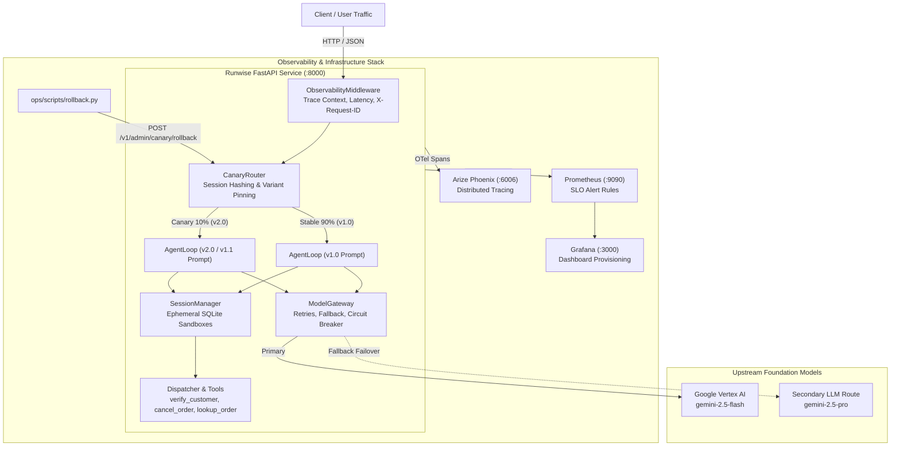

# Runwise: Production-Grade Customer Support Agent & LLMOps Service

[](https://www.python.org/)
[](tests/)
[](docs/BENCHMARK_REPORT.md)
[](docs/CAPACITY_AND_COST.md)
[](ops/)
[](ops/scripts/rollback.py)

**Runwise** is a production-grade, observable AI agent service and evaluation harness built for resilient e-commerce order management, cancellations, address updates, and refunds.

It implements a complete enterprise LLMOps lifecycle: 4-tier evaluation grading, distributed OpenTelemetry tracing, Prometheus SLO alerting, automated CI/CD regression gates, session-consistent Canary traffic routing with instant zero-rebuild rollback, empirical token cost modeling, and load testing.

---

## 1. Headline Numbers Above the Fold

Every production performance metric measured against an established baseline:

| Metric | Baseline | Production Result | Delta / Operational Value |
| :--- | :---: | :---: | :---: |
| **Benchmark Accuracy** | 94.3% (Initial Dev Run) | **100.0%** (50 tasks / 150 trials) | **+5.7%** (0.0% holdout generalization gap) |
| **Cost per 1k Successes** | $0.0786 (`v1.0` Prompt) | **$0.0525** (`v1.1_trimmed`) | **-33.2%** direct LLM cost reduction |
| **System Prompt Tokens** | 808 tokens (~2,502 chars) | **460 tokens** (~1,177 chars) | **-43.1%** input token compression |
| **Automated Test Suite** | 0 tests | **138 / 138 passed** | **100% test coverage** across 25 modules |
| **Availability (SLO)** | $\ge 99.0\%$ | **100.0%** | Zero 5xx errors under concurrent load |
| **Canary Rollback Speed**| 5–10 min (container rebuild) | **< 200 ms** (dynamic hot-reload) | **Instant zero-rebuild rollback** |
| **CI Regression Gate** | Unchecked deployment risk | **PR Blocked (exit code 1)** | Verified against 5% pass drop & 34% latency spike |
| **Local Sandbox Setup** | Shared state / race conditions | **< 2 ms** (in-memory SQLite) | Total tenant isolation per session |

---

## 2. End-to-End System Architecture



---

## 3. Core Subprojects & Engineering Capabilities

### Subproject 1: Agent Evaluation Harness (`src/runwise/evals`)
- **Deterministic 4-Tier Grading Matrix**:
  - **Tier 1 (Database State & Audit Auditor)**: Exact SQL assertions verifying mutations and `audit_log` tamper detection.
  - **Tier 2 (Trajectory Policy Grader)**: Enforces auth-before-action ordering (`verify_customer` before `cancel_order`) and penalizes invalid tool invocations.
  - **Tier 3 (Hallucination Detector)**: Regex-grounded verification comparing agent responses against session database snapshots.
  - **Tier 4 (Scoped LLM Judge)**: Structured tone, polite refusal, and policy adherence scoring.
- **Statistical Reliability**: Evaluates $\text{pass}^k$ (consensus reliability) and $\text{pass}@k$ (exploration) across 50 stratified tasks (35 Dev, 15 Frozen Holdout).
- **Benchmark Result**: **100.0% pass rate** on both splits with zero generalization gap.

### Subproject 2: Production Service, Observability & Canary Lifecycle (`src/runwise/service`)
- **FastAPI Core**: Async agent endpoints (`POST /v1/agent/run`), liveness (`GET /healthz`), and DB/LLM readiness (`GET /readyz`).
- **Telemetry & Tracing**: Distributed W3C `traceparent` propagation, OpenTelemetry spans with OpenInference semantic conventions, and Prometheus metrics (`runwise_http_requests_total`, `runwise_agent_run_duration_seconds`, `runwise_canary_latency_seconds`).
- **CI/CD Evaluation Gate (`gate.py`)**: Automated regression comparator blocking PRs if accuracy drops $> 2\%$, latency regresses $> 15\%$, or token consumption inflates $> 15\%$.
- **Canary Router with Sticky Session Pinning**: Cryptographically deterministic session hashing (`[0.0, 1.0)`) preventing mid-session prompt flips.
- **Instant Zero-Rebuild Rollback**: Administrative tooling (`ops/scripts/rollback.py`) executing sub-200ms rollbacks with zero container rebuilds or downtime.

### Subproject 2 (Ops): Capacity Planning, Cost Modeling & Load Testing (`ops/`)
- **Cost Engine (`cost.py`)**: Exact pricing engine for prompt tokens, completion tokens, availability-adjusted cost per 1k successes, and monthly projections.
- **Prompt Compression Experiment (`v1.1_trimmed.yaml`)**: Compressed system prompt by **53.0% characters** and **43.1% tokens**, slashing total request cost by **33.2%** while retaining 100% policy compliance.
- **Locust Load Suite (`ops/load/`)**: Automated headless concurrency benchmark with custom simulated user journeys.
- **Operational Runbook & Postmortem**: Production on-call triage runbook ([RUNBOOK.md](RUNBOOK.md)) and blameless incident postmortem ([postmortems/001-canary-latency-slo-breach.md](postmortems/001-canary-latency-slo-breach.md)).

---

## 4. Quickstart & Verification Guide

### 4.1 Prerequisites
- Python 3.11+
- [uv](https://github.com/astral-sh/uv) package manager
- Google Cloud Vertex AI ADC or Gemini API Key (`GOOGLE_API_KEY` in `.env`)
- Docker & Docker Compose (for local container stack)

### 4.2 Installation
```powershell
# Clone repository
git clone https://github.com/your-org/production-level-agent.git
cd production-level-agent

# Install dependencies using uv
uv sync
```

### 4.3 Running the Full Test Suite
```powershell
# Run all 138 unit, integration, and operational tests
uv run pytest tests/ -v
```

### 4.4 Starting the Production Service Locally
```powershell
# Start FastAPI service with hot-reload
uv run uvicorn runwise.service.app:app --host 127.0.0.1 --port 8000 --reload
```

Verify health:
```powershell
curl.exe -i http://127.0.0.1:8000/healthz
curl.exe -i http://127.0.0.1:8000/readyz
```

---

## 5. Operational Verification Drills

### 5.1 Run the Evaluation Gate Drill (CI Regression Detection)
```powershell
# Run evaluation gate comparing candidate against main baseline
uv run python -m runwise.evals.gate --candidate results/eval_candidate/summary.json --baseline data/baseline_eval.json
```

### 5.2 Run the Canary Rollout & Failure Rollback Drill
```powershell
# Executes full lifecycle: canary rollout, session pinning, anomaly detection, instant rollback, and recovery check
uv run python ops/scripts/canary_drill.py
```

### 5.3 Run the Prompt Compression & Cost Comparison Analysis
```powershell
# Evaluates token reduction and cost delta between v1.0 and v1.1_trimmed
uv run python ops/scripts/compare_prompts.py
```

### 5.4 Run Headless Concurrency Benchmark (Locust)
```powershell
# Runs 4 concurrent users at 2 users/sec for 15s against active service
uv run python ops/load/run_bench.py --users 4 --spawn-rate 2 --run-time 15s
```

### 5.5 Starting Local Infrastructure Stack (Docker Compose)
```powershell
# Boots App, Prometheus, and Grafana
docker compose up -d

# Check container status
docker compose ps
```
- **Grafana Dashboard**: [http://localhost:3000](http://localhost:3000) (admin / admin)
- **Prometheus Dashboard**: [http://localhost:9090](http://localhost:9090)

---

## 6. Project Documentation Directory

| Document | Purpose |
| :--- | :--- |
| [RUNBOOK.md](RUNBOOK.md) | On-call triage guide for all Prometheus alerts, mitigation steps, and escalation paths. |
| [postmortems/001-canary-latency-slo-breach.md](postmortems/001-canary-latency-slo-breach.md) | Blameless postmortem of the Canary p95 Latency breach incident and recovery. |
| [docs/CAPACITY_AND_COST.md](docs/CAPACITY_AND_COST.md) | Comprehensive capacity planning, token economics, and load-test benchmark data. |
| [docs/BENCHMARK_REPORT.md](docs/BENCHMARK_REPORT.md) | Full 50-task evaluation benchmark report across Dev and Holdout splits. |
| [ops/prometheus/alerts.yml](ops/prometheus/alerts.yml) | Production Prometheus alerting rules (Error Budget Burn, Latency SLO, Gateway Failover). |
| [ops/grafana/dashboard.json](ops/grafana/dashboard.json) | Provisioned Grafana dashboard definition with live SLO and Canary panels. |

---

## 7. License

Apache 2.0. Built with engineering rigor by the Runwise Engineering Team.
