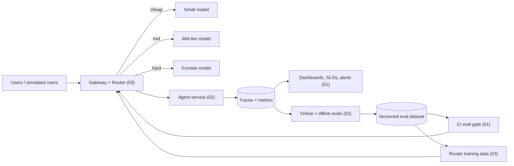

## Build all three as one system

The three projects fit together. Built as one system, they tell the strongest story you can bring to an interview: *"I built an agent, run it in production, measure how often it's wrong, and cut its cost by X% without losing quality."*

Recommended order if you do all three:

1. Build a small agent and its eval harness (02, milestones M0–M3).
2. Wrap the agent in the LLM Ops stack (01).
3. Use the per-model eval results as training labels for the router (03).
4. Close the loop: production failures feed the eval set, the eval set gates deploys and retrains the router.

## Rules for every project

- **Pick a task with ground truth.** If you can't say what "correct" means, you can't measure it, and an unmeasured project lands in pile one.
- **Back every claim with a number.** Each number in the README needs a baseline, a sample size, and a short note on how it was measured.
- **Baseline everything.** "92% accuracy" tells a reviewer nothing. "92% vs 81% for the single-prompt baseline, n=300, ±3 pts 95% CI" does.
- **Show your failures.** A "What broke" section is usually the most convincing part of the README.
- **Make it run with one command**, such as `make demo` or `docker compose up`, plus an `.env.example`.
- **Stay vendor-neutral.** Call models through an OpenAI-compatible layer (e.g. LiteLLM) so you can swap providers. Frameworks are fine for plumbing, but the part you claim to have built has to be your own code.
- **Control spend.** Set hard spending limits with your providers on day one, and cache every model response to disk while developing.
