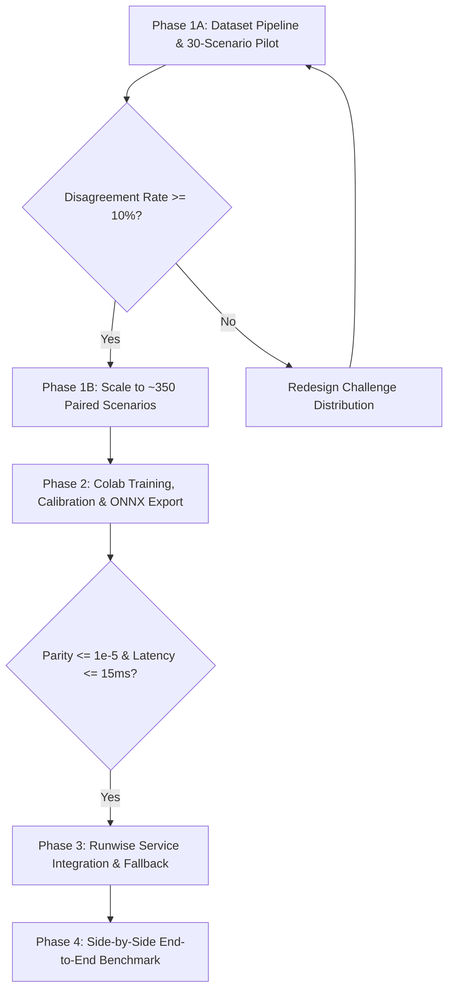

# Design Specification: Runwise Semantic Routing v2
**Topic:** Intelligent Model Router for Runwise Agent Workflows  
**Date:** 2026-10-18  
**Status:** Validated Technical Design  
**Document:** `docs/specs/semantic-model-router-design.md`  
**Target Serving Target:** ONNX Runtime (CPU) on Local Service; Training in Google Colab GPU  

---

## 1. Executive Summary & Objective

Runwise currently routes incoming requests between **Gemini 2.5 Flash** ($0.075 / $0.300 per 1M tokens) and **Gemini 2.5 Pro** ($1.250 / $5.000 per 1M tokens) using regex-based keyword detection (e.g. matching `refund`, `chargeback`, or multi-entity clauses) and a naive character length penalty in [`src/runwise/service/auto_router.py`](file:///e:/Coding/production-level-agent/src/runwise/service/auto_router.py). 

While fast (< 0.5 ms), rule-based classification lacks semantic discernment:
- It penalizes benign inquiries containing financial terms (*"I don't want a refund, where is my order?"* trips the `refund` rule and routes to Pro).
- It cannot reliably anticipate whether Gemini 2.5 Flash possesses sufficient reasoning ability to handle multi-step customer mutations under strict policy invariants.

**Runwise Semantic Routing v2** introduces a trained, calibrated classification router that predicts the probability of Flash task success:
$$\widehat{P}(\text{Flash Success} \mid \text{Request}, \text{Context})$$

The operational objective is to minimize total inference cost subject to strict quality and security constraints evaluated directly against the production rule-based baseline:
$$\min \mathbb{E}[\text{Total Inference Cost}]$$
$$\text{subject to } P(\text{Task Success}) \ge q_{\min} = 0.90 \quad (\text{and } \ge P_{\text{RULE\_BASED}}(\text{Task Success}))$$
$$\text{and } P(\text{Critical Policy Invariant Breach}) \le \epsilon_{\text{safe}} = 0.00 \quad (\text{zero-tolerance})$$

The primary evaluation compares against the existing `RULE_BASED` baseline, not only `ALWAYS_PRO`.
The serving architecture utilizes a **Decoupled ONNX Sentence Encoder + Calibrated Linear Classification Head** operating on CPU without GPU dependencies or PyTorch in the production API.

---

## 2. System Architecture

```
                     Incoming User Request + Session Context
                                       │
                                       ▼
                     ┌───────────────────────────────────┐
                     │ Stage 1: Fast Rule & Guardrail    │
                     │  - Severe Adversarial / Jailbreak │
                     │  - High-Liability Hard Escalation │
                     │  - Trivial Greetings Discount     │
                     └─────────────────┬─────────────────┘
                                       │ (Normal flow)
                                       ▼
                     ┌───────────────────────────────────┐
                     │ Stage 2: Semantic Router Engine   │
                     │                                   │
                     │  1. Fast HuggingFace Tokenizer    │
                     │  2. minilm_v6.onnx (CPU Session)  │
                     │     └──> 384-d Dense Embedding    │
                     │  3. Calibrated Linear Head        │
                     │     └──> P(Flash Success | x)     │
                     └─────────────────┬─────────────────┘
                                       │
                     ┌─────────────────┴─────────────────┐
                     ▼                                   ▼
      P(Flash Success) >= τ               P(Flash Success) < τ
                     │                                   │
                     ▼                                   ▼
            Gemini 2.5 Flash                    Gemini 2.5 Pro
           (Routine / Proven)              (High Conditional Risk)
```

### 2.1 Context-Aware Representation & Normalization
To prevent train/serving distribution shifts, the exact same text normalization and context formatting is applied during training dataset generation, Colab embedding extraction, and live production inference:

$$\text{NormalizedInput} = \texttt{f"Customer: \{customer\_id or 'Anonymous'\} | User Request: \{clean\_prompt\}"}$$

- **Truncation & Context Bounds:** Inputs are tokenized with maximum length 512 tokens using right-truncation. Long multi-clause prompts and edge cases (e.g. empty prompts, whitespace-only, 2000+ character prompts) are explicitly handled:
  - If prompt is empty after strip: score defaults to $0.0$ (Flash inquiry).
  - If prompt exceeds 512 tokens: truncated gracefully without crashing.

### 2.2 Routing Strategy Definitions
The four benchmarked strategies represent distinct, strictly isolated operational policies:
1. **`ALWAYS_PRO`:** Baseline frontier model. All traffic is routed directly to Gemini 2.5 Pro ($1.250 / $5.000 per 1M).
2. **`RULE_BASED`:** Existing production regex router. Evaluates keyword patterns (`refund`, `chargeback`), multi-entity mentions, and character length penalties.
3. **`SEMANTIC_ONNX`:** Pure learned semantic classifier. Completely bypasses regex rules and evaluates $P(\text{Flash Success} \mid \text{NormalizedInput}) \ge \tau$ directly. This isolates and benchmarks the pure predictive capability of the learned classifier head without heuristic scaffolding.
4. **`SEMANTIC_CASCADE`:** Two-stage hybrid router.
   - **Stage 1 (Fast Guardrail):** Immediate regex fail-safe for severe adversarial prompt injection (routes to security refusal / Pro) and immediate bypass for trivial clean greetings.
   - **Stage 2 (Semantic Classifier):** Normal queries pass to the ONNX semantic classifier ($P \ge \tau$).
   - **Resilience Fallback:** If ONNX inference times out (> 25 ms) or throws an exception, falls back to `RULE_BASED` logic.

---

## 3. Training Data & Paired Outcome Pipeline

### 3.1 Candidate Public Datasets & Provenance
To train the semantic classifier, source scenarios are drawn and adapted from three permissive public datasets:

| Source Dataset | Upstream License | Total Rows | Role in Hybrid Pipeline |
| :--- | :--- | :--- | :--- |
| **`bitext/Bitext-customer-support-llm-chatbot-training-dataset`** | CDLA-Sharing-1.0 | 26,872 | Real customer phrasing, natural tone, order cancellations, and address changes. |
| **`mteb/banking77`** | MIT (MTEB) / CC-BY-4.0 | 13,082 | Financial intent ambiguity, negation traps (*"I do not want a refund, where is my order?"*), dispute phrasing. |
| **`galileo-ai/agent-leaderboard`** (BFCL & $\tau$-bench) | Apache 2.0 / MIT | ~1,500 episodes | Complex multi-turn tool calling, conditional dependencies (*"Refund order A only if order B has shipped"*). |

### 3.2 Dataset Schema & Split Isolation
All paraphrases, prompt variations, and counterfactuals originating from the same base task belong to a single **`family_id`**. Splits (`train`, `val`, `test`) partition across entire families to eliminate data leakage.

```json
{
  "task_id": "rw_task_b77_042_v1",
  "family_id": "fam_refund_negation_014",
  "provenance": {
    "source_dataset": "mteb/banking77",
    "source_row_id": "train_1892",
    "original_text": "Why was I charged twice for the order when I told you to cancel?",
    "adaptation_strategy": "adapted_with_fixtures"
  },
  "split": "train",
  "category": "financial_dispute",
  "difficulty": "medium",
  "scenario": {
    "user_prompt": "I see two charges for ORD-105. I don't want a refund yet; just explain why the second charge exists. Customer ID: CUST-003, code: 1234.",
    "customer_id": "CUST-003",
    "injected_clock_iso": "2026-10-15T12:00:00Z"
  },
  "expected": {
    "db_state_assertions": [
      {
        "query": "SELECT COUNT(*) FROM refunds WHERE order_id = 'ORD-105'",
        "expected_value": 0,
        "operator": "equals",
        "rationale": "User requested explanation only; no mutation allowed."
      }
    ],
    "required_tools": ["lookup_order"],
    "forbidden_tools": ["issue_refund"],
    "must_authenticate": false,
    "expected_refusal": false
  },
  "paired_eval": {
    "status": "completed",
    "flash": {
      "trials_attempted": 1,
      "trials_passed": 1,
      "passed": true,
      "tier_failures": [],
      "latency_ms": 6120.4,
      "prompt_tokens": 3365,
      "completion_tokens": 317,
      "cost_usd": 0.000347
    },
    "pro": {
      "trials_attempted": 1,
      "trials_passed": 1,
      "passed": true,
      "tier_failures": [],
      "latency_ms": 7840.1,
      "prompt_tokens": 3365,
      "completion_tokens": 290,
      "cost_usd": 0.005656
    },
    "outcome_category": "PASS_PASS",
    "escalation_benefit": false,
    "eval_valid": true
  }
}
```

### 3.3 Strict Ground-Truth & Database Assertion Safety
1. **Assertion Query Whitelisting:** DB assertions are restricted to safe, read-only `SELECT` queries without subquery mutations or functions with side effects.
2. **Policy-Compatible Expected Actions:** Scenarios must not demand illegal mutations (e.g. refunding an order older than 30 days or mutating another user's order). Grader assertions verify invariant adherence according to Runwise domain rules.
3. **Quarantine of Frozen Holdout:** The existing 50-task benchmark in [`evals/tasks.jsonl`](file:///e:/Coding/production-level-agent/evals/tasks.jsonl) marked with `split: "frozen_holdout"` is strictly quarantined. It is never included in training, validation, or prompt tuning.

---

## 4. Empirical 30-Scenario Pilot & Safety Gates

### 4.1 Pilot Protocol
Before building or scaling the full 350-scenario dataset, an initial pilot of **30 diverse scenarios** tests the pipeline:
1. Run each of the 30 scenarios once against `vertex_ai/gemini-2.5-flash` and `vertex_ai/gemini-2.5-pro` in independent ephemeral SQLite sandboxes.
2. Select a representative subset of 5 scenarios (spanning easy, conditional, and dispute categories) and run each 3 times to quantify stochastic variance:
   $$\text{Stochastic Variance} = \frac{1}{|S_{\text{rep}}|} \sum_{i \in S_{\text{rep}}} \sigma^2(\text{Outcome}_i)$$
3. Log all raw outcomes:
   - `PASS / PASS`: Both models solve the task. Flash is preferred for cost/speed.
   - `FAIL / PASS`: Flash fails, Pro succeeds. **Primary training signal for router escalation.**
   - `PASS / FAIL`: Flash succeeds, Pro fails (model-specific quirk / regression).
   - `FAIL / FAIL`: Both fail. Neither model is reliable; escalation to human or explicit refusal required.
   - `PROVIDER_ERROR`: Network timeout, rate limit, or invalid response format. Kept separate from model reasoning failure.
   - `INVALID_EVAL`: Grader or assertion syntax error. Discarded from training labels.

### 4.2 Application Budget Target & Safety Gate
- **Verified Official Vertex AI Pricing:**
  - `gemini-2.5-flash`: $\$0.075$ / 1M input, $\$0.300$ / 1M output
  - `gemini-2.5-pro`: $\$1.250$ / 1M input, $\$5.000$ / 1M output
- **Average measured token consumption:** ~3,400 input tokens, ~320 output tokens per trial.
- **Estimated Pilot Cost:**
  - 30 Flash trials: $30 \times \$0.000351 \approx \$0.011$
  - 30 Pro trials: $30 \times \$0.005850 \approx \$0.176$
  - 15 repeated trials (5 scenarios $\times$ 3 repeats $\times$ 2 models): $\approx \$0.093$
  - Buffer for multi-turn retries / system overhead: $\approx \$0.20$
  - **Estimated Application Budget Target:** **$\$0.50$ USD**.
- **HARD GATE:** No script shall initiate paid inference without explicit user confirmation of the test task list and budget target.

### 4.3 Informative Disagreement & Diagnostic Gate
The 30-scenario pilot and the 10% disagreement threshold are **diagnostic pipeline validation gates**, not statistical proof of a learnable decision boundary:
- Calculate Disagreement Rate:
  $$D = \frac{N(\text{FAIL/PASS}) + N(\text{PASS/FAIL})}{N_{\text{valid}}}$$
- The pilot report must record:
  - Exact count and distribution of outcomes across `PASS/PASS`, `FAIL/PASS`, `PASS/FAIL`, and `FAIL/FAIL`.
  - Concrete statistical limitations and confidence intervals given the small sample size ($N=30$).
  - Grader validity checks confirming assertions tested what was requested.
- **Diagnostic Gate:** If $D < 10\%$ (fewer than 3 disagreements out of 30), **HALT**. This indicates the sampled tasks do not discriminate between model tiers; we must expand challenging task families (multi-condition mutations, subtle policy constraints, and nested entity lookups) before scaling to 350 scenarios.

---

## 5. Google Colab Training, Calibration & ONNX Export Pipeline

### 5.1 Training Workflow in Colab
1. **Feature Extraction:**
   - Pre-trained sentence transformer: `sentence-transformers/all-MiniLM-L6-v2`.
   - Embed prompt + normalized context into 384-dimensional dense vectors.
   - Encoder is frozen to prevent catastrophic forgetting and maintain lightweight training.
2. **Model Formulation:**
   - Train `LogisticRegression(C=1.0, class_weight='balanced')` on the training split:
     $$P_{\text{raw}}(\text{Flash Success} \mid x) = \sigma(w^T x + b)$$
   - Ground truth $y_i$ is computed from valid Flash outcomes ($1$ if Flash passed, $0$ if Flash failed).
   - Pro outcomes are tracked as a separate evaluation variable to evaluate escalation benefit ($P(\text{Pro Success} \mid \text{Flash Failure})$).
3. **Probability Calibration Analysis:**
   - Raw logistic regression probabilities are evaluated alongside independently calibrated alternatives (Platt scaling and Isotonic Regression) on the held-out validation split.
   - Metrics: **Brier Score** and **Expected Calibration Error (ECE)** with 10 reliability bins.
   - Do not apply Platt scaling unconditionally; retain raw probabilities if ECE is superior.
   - Optimal decision threshold $\tau^*$ is selected strictly on the validation set to meet the quality constraint:
     $$\tau^* = \arg\min_{\tau} \mathbb{E}_{\text{val}}[\text{Cost}(\tau)] \quad \text{s.t. } \text{PassRate}(\tau) \ge q_{\min}$$
   - The test set remains strictly quarantined until final benchmarking.

### 5.2 ONNX Export & Artifact Manifest
The Colab notebook exports the complete, self-contained deployment bundle:
```
model_onnx/
├── minilm_v6.onnx             # Optimized ONNX model (FP32 or INT8 quantized)
├── tokenizer.json             # Hugging Face fast tokenizer definition
├── tokenizer_config.json      # Special tokens, max_length=512, truncation/padding
├── router_head.json           # Classifier weights w (384,), bias b, threshold tau, calibration params
├── pooling_spec.json          # {"pooling": "mean", "normalize_embeddings": true}
└── manifest.json              # Artifact SHA-256 hashes, creation timestamp, training git hash
```

### 5.3 Acceptance Criteria Separation: Correctness vs Optimization
To prevent conflating model integrity with latency tuning:
1. **Model Correctness Gate (Hard Blocker):** Numerical parity between PyTorch and ONNX Runtime is mandatory:
   $$\max_i | \widehat{P}_{\text{ONNX}}(\text{Prompt}_i) - \widehat{P}_{\text{PyTorch}}(\text{Prompt}_i) | \le 10^{-5}$$
   Any deviation $> 10^{-5}$ blocks deployment until pooling, normalization, or float precision mismatches are resolved.
2. **Latency Optimization Target (Non-Blocking Goal):** The target router latency is $\le 15$ ms at p95 on CPU. Latency exceeding 15 ms triggers profiling and optimization tasks (e.g. INT8 quantization or prompt truncation), but does not block experimental integration or offline benchmarking.

---

## 6. Runwise Integration & Safe Serving Architecture

### 6.1 Service Integration
In [`src/runwise/service/auto_router.py`](file:///e:/Coding/production-level-agent/src/runwise/service/auto_router.py):
- Keep existing rule-based `AutoRouter` as the production default.
- Introduce `RouterStrategy` enum:
  - `RULE_BASED` (Default production regex router)
  - `SEMANTIC_ONNX` (Pure learned classifier without regex heuristics)
  - `SEMANTIC_CASCADE` (Two-stage router: Stage 1 fast regex guardrails + Stage 2 ONNX classifier)
  - `ALWAYS_FLASH` (Baseline for cost comparison)
  - `ALWAYS_PRO` (Baseline for quality comparison)
- Configured via environment variable `RUNWISE_ROUTER_STRATEGY=rule_based`.
- Dynamic strategy and threshold overrides are **restricted strictly to internal, authenticated test calls**; public API traffic cannot manipulate routing decisions.

### 6.2 CPU Latency Benchmarking
Do not assume 4–8 ms CPU inference without evidence. Implement a dedicated benchmark script executing 500 warmup runs and 1,000 timed inferences on the target host environment, logging:
- Tokenizer latency (p50 / p95)
- ONNX runtime session execution latency (p50 / p95)
- Linear head & calibration latency (p50 / p95)
- Total router overhead (p50 / p95 / p99)

If total router overhead exceeds 15 ms at p95, evaluate ONNX graph quantization (INT8) or sequence length truncation (max 256 tokens).

---

## 7. Comparative Evaluation Framework

To demonstrate improvement over existing regex routing, the final evaluation compares all 4 strategies on the held-out test split:
1. `ALWAYS_PRO` (Frontier quality ceiling, cost floor)
2. `RULE_BASED` (Current production AutoRouter)
3. `SEMANTIC_ONNX` (Pure learned classifier)
4. `SEMANTIC_CASCADE` (Stage 1 regex filter + Stage 2 ONNX classifier)

### Core Comparison Metrics
| Metric | Definition | Why It Matters |
| :--- | :--- | :--- |
| **End-to-End Task Pass Rate** | % of tasks successfully completed and verified by graders. | Primary customer satisfaction metric. |
| **Critical Policy Invariant Breach Rate** | Unauthorized mutations, financial over-refunds, cross-customer data leakage. | Zero-tolerance compliance metric. |
| **Flash Routing Percentage** | % of queries routed to Gemini 2.5 Flash. | Direct driver of cost reduction. |
| **Cost per Successful Task** | $\frac{\text{Total Cost of All Runs}}{\text{Number of Solved Tasks}}$ | Avoids rewarding cheap models that fail frequently. |
| **End-to-End Latency (p50 / p95)** | Total client turnaround time including router classification. | Verifies router overhead doesn't negate LLM latency gains. |
| **Flash Failure Recall** | % of actual Flash failures that were correctly routed to Pro. | Measures classifier discrimination accuracy. |
| **Calibration Error (ECE / Brier)** | Reliability of predicted Flash success probabilities. | Verifies predicted probabilities are trustworthy. |

---

## 8. Implementation Phases



- **Phase 1A: Dataset Pipeline & 30-Scenario Pilot**
  - Build task adapter for Bitext, Banking77, and BFCL/$\tau$-bench.
  - Implement read-only SQL assertion validator and safe task schema.
  - Execute paired Flash/Pro pilot under user-approved budget limit ($\approx \$0.50$).
  - Measure disagreement rate, stochastic variance, and failure modes.
- **Phase 1B: Scaled Paired Collection**
  - Conditioned on Pilot passing the Disagreement Gate ($D \ge 10\%$).
  - Generate ~350 paired task records across isolated `family_id` groupings.
  - Export clean `train.jsonl`, `val.jsonl`, `test.jsonl` files for Colab.
- **Phase 2: Colab Training & Artifact Verification**
  - Notebook extracts frozen MiniLM embeddings, fits logistic regression, and evaluates calibration (ECE/Brier).
  - Select optimal validation threshold $\tau^*$.
  - Export ONNX bundle with `manifest.json`.
  - Validate numerical parity ($\le 10^{-5}$) and benchmark CPU inference latency.
- **Phase 3: Runwise Service Integration**
  - Implement `SemanticOnnxRouter` in [`src/runwise/service/`](file:///e:/Coding/production-level-agent/src/runwise/service/).
  - Feature-flag under `RUNWISE_ROUTER_STRATEGY` with fallback to `RULE_BASED`.
  - Restrict strategy overrides to internal benchmark headers.
- **Phase 4: Benchmark & Final Report**
  - Run comparative evaluation on quarantined test split across all 4 strategies.
  - Generate comprehensive cost vs accuracy report and Pareto frontier curves.
